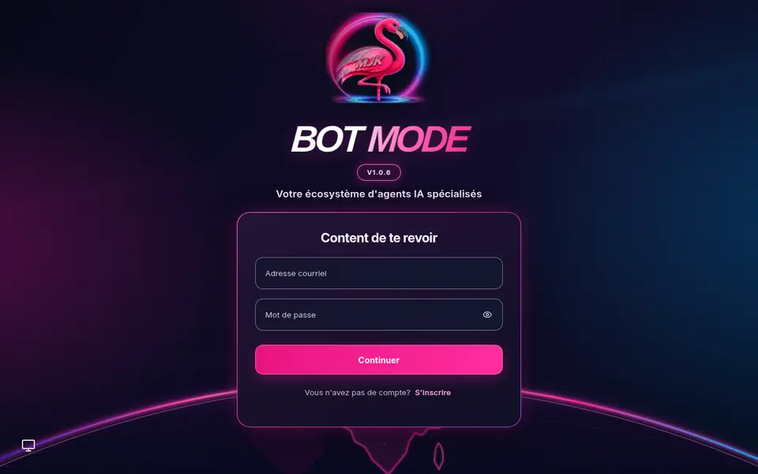

# BOT MODE V1 — LibreChat, de la demande à une réponse vérifiée

**BOT MODE transforme LibreChat en espace de missions multi-agents.** Un orchestrateur prépare le travail, mobilise les spécialistes utiles, regroupe leurs résultats et ne publie la réponse finale qu'après les contrôles prévus.

**Ce n'est pas un nouveau moteur de chat :** BOT MODE s'intègre directement au runtime de [LibreChat](https://github.com/danny-avila/LibreChat), avec ses conversations, ses projets et son interface.

## Aperçu visuel — MJK V11

<p align="center">
  
</p>

<p align="center">
  
</p>

<p align="center"><em>Capture de l'interface réelle, sans identifiants. Le thème MJK V11 est une personnalisation optionnelle de l'image stable V1.0.6, pas une nouvelle release.</em></p>

**Personnalisation graphique :** [aperçu et documentation MJK V11](docs/branding/MJK_V11.md). Le globe reprend la maquette validée ; en bas à gauche les initiales de l'utilisateur connecté sont conservées, avec un habillage rose et bleu.

**Version stable publiée : [v1.0.6](https://github.com/Arkos77/LibreChat-BOTMODE-V1/releases/tag/v1.0.6) — 11 novembre 2026.** Source Git `416bf00898a6b0fb2eaf271ee4671d30ea55ccf0`, image Docker multiarchitecture **Linux AMD64 et ARM64**. Le profil **Lite** vise notamment les machines CPU-only et les CPU x86_64 sans AVX.

> **Référence reproductible :** cloner le tag Git `v1.0.6` et utiliser l’image `ghcr.io/arkos77/librechat-botmode-v1@sha256:e3640ac10833e4743796589b53d8a935d94867d73b0c25e82b4e7e1eba985cdb`. Les alias Docker `stable` ou `latest` ne sont pas des références de cette release.

> **Systèmes :** Linux et ses conteneurs AMD64/ARM64 ont été qualifiés en CI. Un Chromebook via Crostini et un MacBook sous Xubuntu exécutent Linux, mais le déploiement sur chaque appareil n'est pas certifié par ces tests. macOS natif (Docker Desktop) et Windows/WSL2 disposent de procédures documentées, **sans réception V1.0.6 sur ces OS**. L'installation concerne une machine neuve, non une migration ; les machines existantes n'ont pas été mises à jour.

## Pourquoi BOT MODE ?

Au lieu d'attendre qu'un seul agent accomplisse toutes les étapes, BOT MODE structure les missions :

```text
Votre demande dans LibreChat
            │
            ▼
   BOT MODE Worker
   organise la mission
            │
            ▼
 Recherche → Analyse → Synthèse
            │
            ▼
  Contrôles indépendants Oracle
            │
            ▼
 Publication unique sous barrière P6
            │
            ▼
      Réponse finale
```

- **Orchestration native :** le Worker coordonne les étapes et les spécialistes, sans devenir un outil d'exécution universel.
- **Spécialistes à responsabilités distinctes :** Recherche, Analyse, Code, Documents et Rédaction/Synthèse ; chacun n'utilise que les capacités autorisées pour sa tâche.
- **Contrôle des résultats :** Oracle vérifie indépendamment les étapes ; la barrière P6 protège la publication de la réponse finale.
- **Missions durables :** état de mission, preuves et résultats conservés pour la consultation et la reprise selon le scénario.
- **Intégration LibreChat :** conversations, projets, progression visible et résultats conservés.
- **Profil Lite :** image prête à l'emploi, MongoDB et Redis légers, sans compilation locale lourde.

**Limite de sécurité Lite :** pour rester compatible avec certains CPU anciens sans AVX, ce profil utilise MongoDB 4.4.29, branche arrivée en fin de support fournisseur. Ce profil vise un usage local protégé ; ne pas exposer MongoDB ni présenter cette dépendance comme recevant des mises à jour de sécurité. Le profil Full demande du matériel plus récent, au minimum 4 Gio de mémoire et AVX sur x86_64. Les capacités Code Interpreter et Documents/RAG ne sont pas incluses ni validées dans le Lite par défaut.

**Parcours réel vérifié en V1.0.3 :** Recherche → Analyse → Synthèse, 3 étapes Oracle VERIFIED, une publication P6 et la persistance des résultats. D'autres capacités dépendent des outils et services configurés ; elles ne sont pas toutes validées sur toutes les plateformes.

## Installation par machine

**Choisissez votre système avant de copier les commandes :** [Chromebook ChromeOS / Crostini](docs/BOT_MODE_INSTALL_PAR_MACHINE.md#chromebook--chromeos-et-linux-crostini), [Ubuntu / Xubuntu](docs/BOT_MODE_INSTALL_PAR_MACHINE.md#ubuntu-ou-xubuntu--pc-linux-et-macbook-sous-linux), [Debian](docs/BOT_MODE_INSTALL_PAR_MACHINE.md#debian--autre-pc-linux), [Fedora](docs/BOT_MODE_INSTALL_PAR_MACHINE.md#fedora--autre-pc-linux), [macOS](docs/BOT_MODE_INSTALL_PAR_MACHINE.md#macos--mac-intel-ou-apple-silicon) ou [Windows / WSL2](docs/BOT_MODE_INSTALL_PAR_MACHINE.md#windows-1011--wsl2-et-docker-desktop).

Le **[guide d'installation adapté à chaque machine](docs/BOT_MODE_INSTALL_PAR_MACHINE.md)** explique comment préparer Git, Docker et Compose v2, puis propose les commandes de la **v1.0.6** pour un ordinateur neuf. **L'installateur choisit Lite ou Full automatiquement** selon la mémoire et l'AVX sur x86_64 ; sur macOS/Windows, l'installation reste à qualifier sur matériel réel. Pour démarrer avec le profil Lite explicitement, utilisez les commandes ci-dessous.

## Installation rapide — nouvelle machine

### Prérequis

- Linux AMD64 ou ARM64, ou **ChromeOS avec Linux (Crostini)** ; d'autres plateformes utilisent Docker mais n'ont pas toutes la même qualification réelle.
- Git, Docker Engine actif, **Docker Compose v2** et OpenSSL.
- Connexion Internet pour télécharger l'image Docker.
- Port **3080** disponible. Prévoir de l'espace disque pour les images et les volumes persistants.

Vérifiez Docker :

```bash
git --version
docker --version
docker compose version
docker info >/dev/null
openssl version
```

### Installer BOT MODE V1.0.5 en profil Lite

Sur une **installation neuve**, copiez les commandes suivantes :

```bash
git clone --branch v1.0.6 --depth 1 \
  https://github.com/Arkos77/LibreChat-BOTMODE-V1.git

cd LibreChat-BOTMODE-V1

# Vérifier la révision publiée : la commande s'arrête en cas d'écart.
test "$(git rev-parse HEAD)" = \
  416bf00898a6b0fb2eaf271ee4671d30ea55ccf0

# Conserver explicitement l'accès local (réglage par défaut en v1.0.6).
BOTMODE_HOST_BIND_IP=127.0.0.1 ./install.sh --lite --image \
  ghcr.io/arkos77/librechat-botmode-v1@sha256:e3640ac10833e4743796589b53d8a935d94867d73b0c25e82b4e7e1eba985cdb
```

L'installateur vérifie Docker/Compose, prépare le fichier local `.env`, génère les identifiants de base de données nécessaires sur une installation neuve, télécharge l'image et démarre les services.

**Sécurité v1.0.6 :** l'API (port 3080) et le panneau d'administration Full (port 3000) écoutent sur `127.0.0.1` par défaut dans Docker Compose. Pour conserver un choix explicite lors des redémarrages, notez `BOTMODE_HOST_BIND_IP=127.0.0.1` dans `.env`. Un accès distant exige un proxy TLS, un contrôle d'accès et une configuration de `TRUST_PROXY` adaptée. Ne journalisez pas les paramètres OAuth `code`/`state` sur le frontal.

**Après le démarrage :**

1. Configurez **votre propre clé de fournisseur** dans `.env` (par exemple un modèle gratuit disponible via OpenRouter). Ne publiez jamais ce fichier et ne transmettez jamais vos clés.
2. Si vous avez modifié `.env` après le premier démarrage, appliquez ces changements avec `./stop.sh` puis `./start.sh` ; les volumes de données sont préservés.
3. Ouvrez **http://localhost:3080**, créez votre compte, puis terminez l'initialisation BOT MODE depuis l'interface LibreChat.
4. Vérifiez l'état des services avec `./doctor.sh --lite`.

**Attention :** ces commandes sont destinées à une machine ou installation neuve. **N'exécutez pas une nouvelle installation par-dessus une stack existante** sans sauvegarde, inventaire des volumes et procédure de migration.

### Autres commandes utiles

```bash
./install.sh --help   # Options et profils disponibles
./doctor.sh --lite    # Diagnostic
./stop.sh             # Arrêt sans suppression des volumes
./start.sh            # Redémarrage avec l'image configurée
```

Le profil peut être choisi automatiquement avec `./install.sh --image <IMAGE_VALIDÉE>` ; le profil **Full** demande au moins 4 Gio de mémoire et, sur x86_64, un CPU compatible AVX. Pour une version épinglée, **n'utilisez pas `./update.sh`** : il refuse volontairement les tags Git détachés.

Le [guide complet d'installation](docs/BOT_MODE_INSTALL.md) couvre la configuration et le provisionnement ; les sauvegardes et migrations d'installations existantes exigent une qualification séparée.

## Image officielle et reproductibilité

- **Code source :** [tag v1.0.6](https://github.com/Arkos77/LibreChat-BOTMODE-V1/tree/v1.0.6)
- **Commit :** `416bf00898a6b0fb2eaf271ee4671d30ea55ccf0`
- **Image :** `ghcr.io/arkos77/librechat-botmode-v1@sha256:e3640ac10833e4743796589b53d8a935d94867d73b0c25e82b4e7e1eba985cdb`
- **Architectures :** Linux AMD64 / ARM64
- **Preuves V1.0.6 :** [publication GHCR, AMD64/ARM64, pull anonyme et démarrage Lite](https://github.com/Arkos77/LibreChat-BOTMODE-V1/actions/runs/42953398588) ; [CI et traçabilité de la PR #180](https://github.com/Arkos77/LibreChat-BOTMODE-V1/pull/180) ; [risques acceptés sous restrictions](https://github.com/Arkos77/LibreChat-BOTMODE-V1/issues/154). Les essais de restauration sur installations existantes ne sont pas déduits du smoke Lite.

La **v1.0.6** a été vérifiée sur runners GitHub Linux AMD64/ARM64, avec pull public et démarrage Lite de l'image GHCR lors de sa publication. Les essais sur Chromebook concernent notamment la release historique **v1.0.3** ; ils ne garantissent pas la compatibilité de chaque matériel.

## Modèles, coûts et sécurité

- Le routage natif par défaut est prévu pour les **modèles explicitement gratuits** configurés dans OpenRouter. Aucun fallback payant automatique n'est autorisé par défaut. **Gratuit ne signifie pas accès illimité :** les fournisseurs imposent leurs propres conditions, disponibilités et quotas.
- Aucune clé API personnelle n'est fournie ni attendue dans Git. Les fichiers `.env` locaux ne doivent jamais être commités.
- Les contrôles de publication ont réussi mais ne constituent pas une certification de sécurité exhaustive : deux alertes CodeQL HIGH OAuth MCP (#331 et #332) restent **ouvertes**, avec atténuation testée et acceptation limitée **aux installations Linux protégées**. Les alertes historiques ne sont pas acceptées en bloc : [registre #154](https://github.com/Arkos77/LibreChat-BOTMODE-V1/issues/154).
- Pour signaler une faille, privilégiez un [signalement privé sur GitHub](https://github.com/Arkos77/LibreChat-BOTMODE-V1/security/advisories/new), sans publier de secrets ni de détails exploitables dans une issue.
- **Licences :** dépôt sous MIT, avec des licences tierces distinctes pouvant imposer d'autres restrictions. Lire [THIRD_PARTY_NOTICES.md](THIRD_PARTY_NOTICES.md), notamment avant toute redistribution commerciale.

## Documentation

- [Guide d'installation et premier démarrage](docs/BOT_MODE_INSTALL.md)
- [Sauvegardes et retour arrière](docs/BOT_MODE_ROLLBACK.md)
- [Méthode de publication publique](docs/BOT_MODE_PUBLIC_RELEASE.md)
- [Risques de dépendances suivis](docs/BOTMODE_V1_NPM_RISK_DECISION_20261014.md)
- [Release v1.0.6 et notes de version](https://github.com/Arkos77/LibreChat-BOTMODE-V1/releases/tag/v1.0.6)

## English summary

**BOT MODE V1 is a native multi-agent orchestration extension for LibreChat.** A Worker coordinates specialized research, analysis and writing steps; independent Oracle checks and a P6 publication barrier control the final answer. A prebuilt, digest-pinned **Lite** Docker image supports Linux AMD64/ARM64, including low-memory CPU-only installations. For setup, use the commands above and the [installation guide](docs/BOT_MODE_INSTALL.md). Free-model access depends on provider quotas and credentials.

## Crédits

BOT MODE est basé sur [LibreChat](https://github.com/danny-avila/LibreChat) et conserve son attribution et sa licence de base. **Ce dépôt est un fork communautaire, pas la distribution officielle du projet LibreChat upstream.**

- LibreChat et ses contributeurs
- Les bibliothèques et fournisseurs intégrés, soumis à leurs licences respectives

Licence du dépôt : [MIT](LICENSE). Voir les [mentions de tiers](THIRD_PARTY_NOTICES.md).
