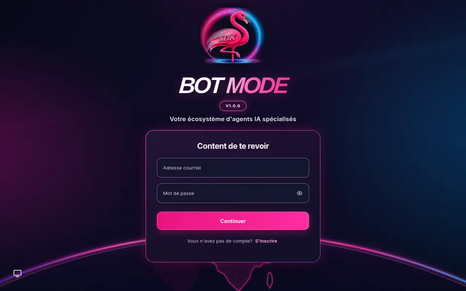

# BOT MODE MJK V11 — Globe de connexion, avatar et présentation GitHub

**Portée :** personnalisation graphique supplémentaire à l’image officielle BOT MODE V1.0.6. Le tag de release et le digest OCI restent inchangés :

`sha256:e3640ac10833e4743796589b53d8a935d94867d73b0c25e82b4e7e1eba985cdb`

## Aperçu



Le README principal affiche cette capture réelle et le logo MJK. La description courte « About » du dépôt ne peut pas afficher directement des images.

## Corrections après V10

- **Connexion :** ajout d’un horizon terrestre néon avec Afrique au centre, redessiné en SVG léger d’après la maquette. C’est un décor en arrière-plan, **pas un globe interactif**.
- **Avatar compte :** les **initiales de l’utilisateur connecté** sont conservées. Pour les seuls avatars SVG générés par DiceBear, CSS rose/bleu et halo appliqués sans dépendre du composant `aside`, ce qui corrige notamment l’apparence sur Chromebook. Les photos de profil téléchargées gardent leurs couleurs.
- **Responsive :** tests de prévisualisation Chromium pour 1280×800, 390×844 et 320×640 ; le formulaire reste lisible et aucune barre de défilement horizontale n’a été détectée.

L’interface conserve tous les champs d’authentification, l’application native, les conversations, les agents, les rôles et les permissions MCP. Il n’y a pas de requête de modèle payant.

## Architecture sans empilement

La V11 **réutilise** les huit ressources statiques de [MJK V10](../../branding/mjk-v10/README.md), sans les dupliquer dans Git. Elle ajoute seulement :
- `branding/mjk-v11/index.html` : index HTML de l’image V1.0.6 avec surcouches CSS V11.
- `branding/mjk-v11/globe.svg` : dessin du globe utilisé par le style de connexion.
- `branding/mjk-v11/login-preview-v11.webp` : capture sans données de compte pour la documentation.

**Le globe est encodé dans l’index HTML** pour éviter un montage Docker supplémentaire. Les neuf montages V10 sont conservés.

## Installer sur une machine déjà dotée de V1.0.6

1. Sauvegarder localement les informations `docker inspect`, les configurations et les données avant toute manipulation.
2. Préparer l’habillage sans remplacer les fichiers installés :

```bash
python3 scripts/branding/stage-v11.py
```

3. Déployer **d’abord sur 3081**, puis contrôler l’application :

```bash
# Chromebook Crostini — instance Compose de test
python3 scripts/branding/deploy-v11-compose.py --container botmode-v100-test-api-1 --port 3081 --confirm

# MacBook Xubuntu — instance Compose de test
python3 scripts/branding/deploy-v11-compose.py --container botmode-v1-mac-litepp-api-1 --port 3081 --confirm
```

4. Après validation, passer au service principal :

```bash
# Chromebook : service Compose
python3 scripts/branding/deploy-v11-compose.py --container librechat-botmode-api-1 --port 3080 --confirm

# Mac : seul cas où le 3080 est un conteneur standalone, pas Compose
python3 scripts/branding/deploy-v11-host-mac.py
```

**Attention :** les noms de conteneurs correspondent aux installations personnelles qualifiées ; adapter à d’autres déploiements nécessite un audit préalable. Pour macOS natif, Windows/WSL2 et d’autres images, aucune qualification nouvelle n’est apportée.

## Vérifications

```bash
for port in 3080 3081; do
  curl -fsS -o /dev/null -w "$port HTTP %{http_code}\n" http://127.0.0.1:$port/login
  curl -fsS http://127.0.0.1:$port/login | grep -q botmode-polish-v11
done
```

Vérifier en **session utilisateur authentifiée** que les initiales restent visibles et que le menu de compte fonctionne, en modes sombre et clair. Un test de CSS sur un avatar simulé ne prouve pas tous les cas réels.

**Retour arrière :** utiliser les inspections et fichiers de composition conservés dans `~/BOTMODE-BACKUPS/pre-globe-v11-20261111/`. Compose : recréer uniquement le conteneur API avec la surcharge V10. Mac 3080 : le conteneur V10 est conservé arrêté, renommé avec le suffixe de sauvegarde ; le script sait le restaurer en cas d’échec.

## Validation du 11 novembre 2026

- Chromebook Crostini AMD64 : ports 3080/3081, HTTP 200, source MJK V11.
- Mac Xubuntu AMD64 : ports 3080/3081, HTTP 200, source MJK V11.
- Tests de connexion Chromium : desktop, mobile, petit mobile, sans débordement horizontal.
- Tests de sélection CSS : filtre de l’avatar généré et contours rose/bleu en clair/sombre.
- **Réception visuelle authentifiée sur Chromebook : à confirmer.**
- Aucune modification des volumes Docker ni du digest de l’image.

Les limitations sécuritaires historiques de BOT MODE V1.0.6 restent applicables.
